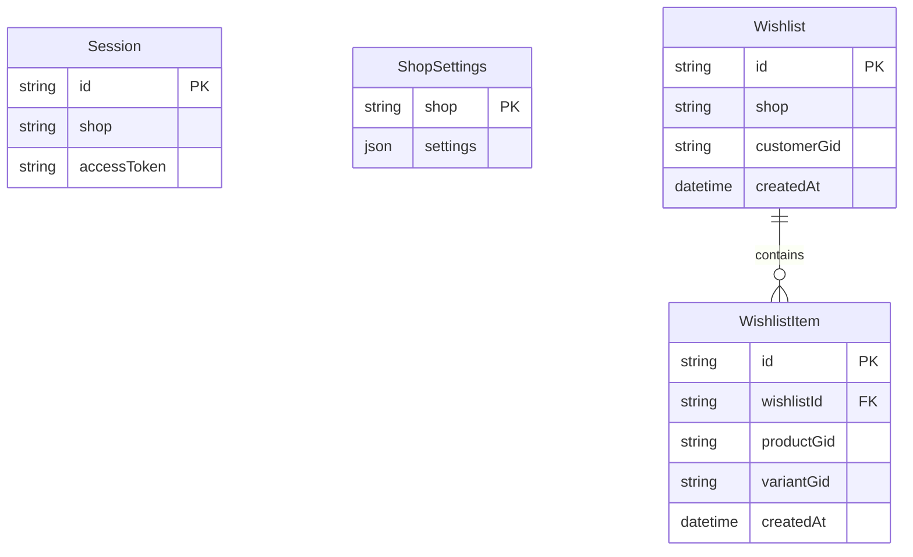
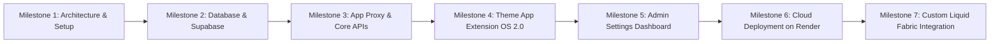

# Decorenn Wishlist App — Project Summary & Architecture Guide

---

## 1. Executive Summary & Purpose

The **Decorenn Wishlist App** (`custom-wishlist-app1`) is a bespoke, high-performance Shopify Wishlist solution built specifically for the **Decorenn** storefront. 

### Why It Was Built
Most third-party wishlist solutions (like Swym, Wishlist Plus, or SE Wishlist Engine) suffer from key limitations:
1. **Recurring Monthly Costs:** Ongoing SaaS subscription fees that scale as store traffic grows.
2. **Third-Party Data Lock-in:** Merchant and customer wishlist data is stored on external third-party servers.
3. **Storefront Bloat & Heavy Scripts:** Bulky third-party JavaScript libraries that degrade Core Web Vitals and Lighthouse performance.
4. **Lack of Deep Customization for Variant/Fabric Swatches:** Generic apps only save parent products, failing to support variant-level wishlists essential for fabric swatches, color options, and custom material pickers.

### The Solution
A custom, lightweight, enterprise-grade Shopify App that gives Decorenn:
- **Zero Recurring SaaS Fees:** Deployed on cost-effective/free cloud infrastructure (Render + Supabase).
- **100% Data Ownership:** All customer wishlists and settings reside in a dedicated PostgreSQL database.
- **Variant-Level Wishlist Tracking:** Customers can heart specific fabric colors, SKUs, and variant configurations.
- **Native Shopify OS 2.0 Integration:** Built using Shopify Theme App Extensions (no intrusive theme code edits; can be toggled on/off in the Theme Editor).
- **Shopify App Proxy:** Clean, first-party URLs (`/apps/wishlist/api/*`) with zero CORS complications and HMAC signature verification.

---

## 2. Technical Stack & Infrastructure

| Layer | Technology | Role / Purpose |
| :--- | :--- | :--- |
| **Storefront Extension** | Shopify Theme App Extension (OS 2.0) | Liquid blocks (`wishlist-embed`, `wishlist-page`), snippets (`wishlist-heart`), vanilla JS, and CSS |
| **Backend Framework** | Node.js (v20) + React Router v7 (`@shopify/shopify-app-react-router`) | Modern, secure full-stack server running OAuth, Admin UI, and Proxy routes |
| **Admin Dashboard UI** | Shopify Polaris & App Bridge | Native Shopify Admin dashboard embedded directly inside Shopify Admin |
| **Database & ORM** | PostgreSQL (Supabase) + Prisma ORM | Stores merchant sessions, custom settings, wishlists, and item variants |
| **API Architecture** | Shopify App Proxy + GraphQL Admin API | Secure frontend-to-backend communication authenticated via Shopify HMAC |
| **Application Hosting** | Render (`https://decorenn-wishlist-app.onrender.com`) | Dockerized production deployment with auto-restart and SSL |

---

## 3. Database Schema Overview (Prisma / PostgreSQL)

The database schema (`prisma/schema.prisma`) is hosted on **Supabase** and handles four key entities:

1. **`Session`**: Manages Shopify merchant OAuth tokens, access scopes, and offline sessions.
2. **`Wishlist`**: Tracks a customer's wishlist tied to their unique Shopify customer ID (`customerGid`) and shop domain.
3. **`WishlistItem`**: Records individual variant entries (`variantGid` and `productGid`) with cascade deletion when a wishlist is cleared.
4. **`ShopSettings`**: Stores merchant visual and functional preferences (icon color, active color, size, page title, empty state text, and collection exclusion list).



---

## 4. Architecture & Key Features

### A. Dual Guest & Logged-In Flow with Automatic Sync
- **Guest Visitors:**
  - Can immediately heart products without an account.
  - Wishlist data is persisted locally in `localStorage` under `wishlist_v1`.
  - Zero server overhead or latency for guest browsing.
- **Logged-In Customers:**
  - Wishlist is stored in the PostgreSQL database.
  - Syncs seamlessly across mobile, tablet, and desktop.
- **Smart Login Merge (`/proxy/api/merge`):**
  - When a guest customer logs into their account, frontend logic automatically submits their guest wishlist to the backend.
  - The backend merges guest items with their saved customer database wishlist without creating duplicates.

### B. Variant-Level Precision (Fabric & Swatch Friendly)
- Built specifically for Decorenn's multi-variant products (e.g., fabric cards with 10+ color swatches).
- Each heart button binds to a specific `variantGid`.
- When users switch color swatches on product cards, the heart button state updates dynamically to reflect whether that specific variant is saved.

### C. Full Wishlist Page (`/pages/wishlist`)
- Rendered via the `wishlist-page` Theme App Block.
- Features dynamic GraphQL hydration:
  - Fetches the latest product titles, variant titles, images, and live prices.
  - Checks real-time stock availability (`availableForSale`).
  - Displays a clean "Add to Cart" button that directly interacts with the Shopify cart API.
  - Features responsive card layout, single-item removal, and pagination / "Load more".

### D. Collection-Based "Add to Cart" & Price Exclusion
- In Decorenn's business model, certain items (such as fabric swatches or made-to-order fabrics) should **not** display a standard direct "Add to Cart" button or price.
- The app includes a merchant configuration setting: `hideAddToCartCollections`.
- When loading wishlist items, the backend inspects the product's collections. If it matches an excluded collection (e.g., `fabric`), the "Add to Cart" button and price are hidden, showing only the Remove button.
- Clicking "Add to Cart" on available products updates the cart seamlessly via Ajax (`/cart/add.js`) and theme events without redirecting the user away from the Wishlist page.

### E. Embedded Merchant Admin Dashboard (`/app`)
- Directly accessible from **Shopify Admin → Apps → custom wishlist app1**.
- **Real-Time Analytics:** Displays total saved items count across the entire store.
- **Design Customizer:**
  - Default Heart Icon Color (hex color picker)
  - Active Heart Icon Color (hex color picker)
  - Icon Size (16px to 48px slider/number input)
- **Content Editor:**
  - Wishlist Page Title (default: "My Wishlist")
  - Empty State Message (default: "You haven't saved anything yet.")
- **Exclusion Manager:**
  - Comma-separated handles of collections where "Add to Cart" should be hidden.
- **Quick Links:**
  - Direct 1-click button opening the Shopify Theme Customizer (`App Embeds` context).

---

## 5. What Has Been Done Till Now (Milestones Completed)



### ✅ Milestone 1: Core Framework Setup
- Initialized official Shopify App template utilizing **React Router v7** and **Vite**.
- Configured Shopify CLI tools and `shopify.app.toml` configuration file.

### ✅ Milestone 2: Cloud Database & Prisma Migration
- Migrated default SQLite setup to **PostgreSQL on Supabase**.
- Set up connection pooling (`aws-0-us-east-1.pooler.supabase.com`) for high concurrency and serverless-friendly connections.
- Designed schemas for `Session`, `Wishlist`, `WishlistItem`, and `ShopSettings`.

### ✅ Milestone 3: App Proxy Backend Endpoints
- Configured Shopify App Proxy on prefix `apps` and subpath `wishlist`:
  - `GET/POST /proxy/api/state`: Returns currently saved variant GIDs.
  - `POST /proxy/api/items`: Adds a variant to the customer's wishlist.
  - `DELETE /proxy/api/items/$variantId`: Removes a variant from the wishlist.
  - `POST /proxy/api/merge`: Merges local guest storage items into customer cloud DB on login.
  - `POST /proxy/api/wishlist`: Queries Shopify Admin GraphQL to return rich product cards (image, handle, variant title, price, currency, availability, and collection checks).
  - `GET /proxy/api/config`: Serves merchant styling configuration to the storefront.

### ✅ Milestone 4: OS 2.0 Theme App Extension (`wishlist-theme`)
- **`blocks/wishlist-embed.liquid`**: Stores global storefront config (`__wishlistConfig`) and loads `wishlist.css` and `wishlist.js`.
- **`blocks/wishlist-page.liquid`**: Section block for rendering `/pages/wishlist` with empty state, retry states, and pagination controls.
- **`snippets/wishlist-heart.liquid`**: Reusable heart button snippet with SVG icons and accessible ARIA attributes.
- **`assets/wishlist.js` & `assets/wishlist-page.js`**:
  - Event delegation on `.fabric_design, .card-wrapper`.
  - Guest `localStorage` handling and auto-fill logic.
  - Instant optimistic UI toggling (turns red immediately on click).

### ✅ Milestone 5: Embedded Merchant Admin Dashboard
- Created `/app._index.jsx` inside Shopify Admin.
- Added live KPI counter for total wishlisted products across the store.
- Provided real-time live preview for icon colors and size.
- Provided inputs for collection exclusions and page copy.

### ✅ Milestone 6: Dockerization & Cloud Deployment on Render
- Built production `Dockerfile` with Alpine Linux and OpenSSL compatibility.
- Deployed live on **Render** at `https://decorenn-wishlist-app.onrender.com`.
- Updated all redirect URLs, OAuth scopes (`read_products`), and webhook subscriptions (`app/uninstalled`, `app/scopes_update`, `products/update`, `products/delete`, and compliance webhooks).

### ✅ Milestone 7: Custom Theme & Liquid Integration
- Replaced legacy, third-party `SE Wishlist Engine` code in `templates/collection.data.liquid` with native Decorenn wishlist button code.
- Supported variant-level targeting on custom fabric grid cards (`data-pid`, `data-vid`, `data-handle`).

---

## 6. Project Directory Map

```text
custom-wishlist-app1/
├── app/
│   ├── routes/
│   │   ├── app._index.jsx             # Admin settings page (colors, titles, stats)
│   │   ├── proxy.api.wishlist.jsx     # App Proxy: Product hydration via GraphQL
│   │   ├── proxy.api.items.jsx        # App Proxy: Add item endpoint
│   │   ├── proxy.api.items.$variantId.jsx # App Proxy: Delete item endpoint
│   │   ├── proxy.api.merge.jsx        # App Proxy: Guest to customer merger
│   │   ├── proxy.api.state.jsx        # App Proxy: Customer wishlist state
│   │   └── proxy.api.config.jsx       # App Proxy: Dynamic merchant styling config
│   ├── shopify.server.js              # Shopify API & authentication handlers
│   └── db.server.js                   # Prisma Client singleton
├── extensions/
│   └── wishlist-theme/
│       ├── blocks/
│       │   ├── wishlist-embed.liquid  # App Embed block for global theme loading
│       │   └── wishlist-page.liquid   # Section block for /pages/wishlist
│       ├── snippets/
│       │   └── wishlist-heart.liquid  # Reusable Liquid heart button snippet
│       └── assets/
│           ├── wishlist.js            # Storefront heart click & card scanner
│           ├── wishlist-page.js       # Wishlist page renderer & cart handler
│           └── wishlist.css           # Styling for hearts, badges, and grids
├── prisma/
│   └── schema.prisma                  # PostgreSQL models (Sessions, Wishlists, Settings)
├── shopify.app.toml                   # Shopify app configuration & proxy definition
└── Dockerfile                         # Container build recipe for Render hosting
```

---

## 7. Current Status & Next Actions

| Area | Status | Notes |
| :--- | :--- | :--- |
| **Backend & APIs** | 🟢 Live & Healthy | Hosted on Render, connected to Supabase PostgreSQL |
| **Merchant Admin** | 🟢 Fully Functional | Polaris dashboard allows styling and collection control |
| **Storefront App Embed** | 🟢 Ready | Can be enabled via Theme Customizer > App Embeds |
| **Wishlist Page Block** | 🟢 Ready | Place block on `/pages/wishlist` template |
| **Liquid Snippet Integration** | 🟢 Integrated | Replaces old SE Wishlist Engine on collection/fabric templates |

### Recommended Final Steps for Live Launch:
1. **Theme App Embed Verification:** Open the live theme editor, verify the **Wishlist** App Embed is toggled **ON**, and save.
2. **Page Creation:** In Shopify Admin → Online Store → Pages, ensure a page titled `Wishlist` (slug: `wishlist`) has the `wishlist-page` section block added.
3. **End-to-End Test:**
   - As a guest: Add 2 items, verify they appear on `/pages/wishlist`.
   - Log in: Verify items automatically sync to the customer account in Supabase.
   - Test "Add to Cart" and verify collection exclusion for fabric swatches.
